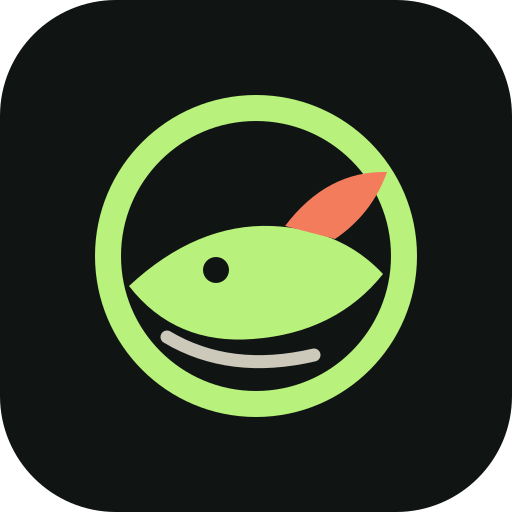
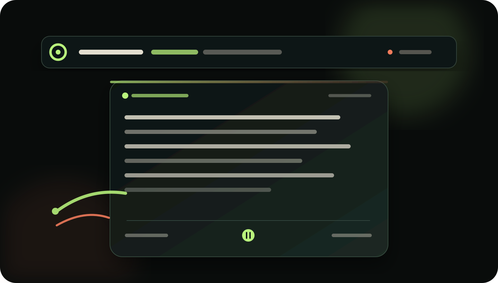

<div align="center">
  
  <h1>WeFish · 上班墨鱼</h1>
  <p>让阅读随时可用，从书架继续读下去。</p>
  <p>
    <a href="https://github.com/Aplus-Nexus/WeFish/releases"></a>
    <a href="LICENSE"></a>
    <a href="https://github.com/Aplus-Nexus/WeFish/actions"></a>
  </p>
</div>



WeFish 是一个支持 macOS 和 Windows 的桌面阅读器。它把微信读书的书架、章节、阅读位置、阅读时长、摘录和书友想法收进一个简洁的阅读窗口；需要减少打扰时，当前行会留在 macOS 菜单栏或 Windows 托盘提示里。

## 1.0.2 能做什么

- **菜单栏逐行阅读**：像歌词一样显示当前行，默认每 1 秒推进，也可以逐行前进或暂停。
- **分页阅读**：一章拆成稳定的阅读页，无正文滚动；自动预加载后两页和下一章首屏。
- **快速定位**：章节选择器、位置滑杆、上一页/下一页和上一章/下一章都可用。
- **云端位置与时长**：逐行阅读偏移、摘要和时长通过 Web Reader 会话上报；网络暂时不可用时进入待同步队列。
- **最近阅读**：书架展示最近打开的书和最近进度，打开后从云端位置继续。
- **阅读数据**：同步微信读书全平台本周、本月阅读时长、活跃天数、笔记、摘录、书友想法与会员权益摘要。
- **当前内容操作**：托盘右键菜单支持复制当前行/段、划线当前行/段；“写想法”会打开小型多行输入框，Enter 换行，Ctrl+Enter 发送。
- **进度显示**：阅读器显示 `x / xx 行`、百分比和 0°–360° 圆环；行数与百分比可分别隐藏，Windows 阅读小窗也会同步显示。
- **低干扰窗口**：阅读舱默认隐藏，菜单栏/托盘图标、系统快捷键和右键菜单都能控制它。
- **安全授权**：Cookie 和 API Key 只留在本地服务与 macOS Keychain / Windows Credential Manager，不进入浏览器页面。

### 快捷键

| 操作 | macOS | Windows |
| --- | --- | --- |
| 显示 / 隐藏阅读舱 | `⌘ ⌥ M` | `Ctrl Alt M` |
| 上一页 / 下一页 | `⌘ ⌥ ← / →` | `Ctrl Alt ← / →` |
| 上一章 / 下一章 | `⌘ ⌥ ⇧ ← / →` | `Ctrl Alt Shift ← / →` |
| 上一行 / 下一行 | `⌘ ⌥ ↑ / ↓` | `Ctrl Alt ↑ / ↓` |
| 暂停 / 启动自动逐行 | `⌘ ⌥ Space` | `Ctrl Alt Space` |
| 同步书架 | `⌘ ⌥ R` | `Ctrl Alt R` |
| 切换小窗模式 | `⌘ ⌥ P` | `Ctrl Alt P` |

## 下载与介绍页

- [GitHub Releases](https://github.com/Aplus-Nexus/WeFish/releases)
- [WeFish 项目介绍页](https://aplus-nexus.github.io/WeFish/)
- [三套 Logo 方案预览](docs/brand/index.html)

当前仓库保留三套 Logo 方向：01「潮汐标」、02「书页标」、03「胶囊字标」。1.0 默认使用 01，欢迎从[预览页](docs/brand/index.html)选择最终品牌方案。

## 开发与测试

```bash
python3 -m unittest discover -s tests -v
python3 -m PyInstaller --noconfirm --clean WeFishService.spec

cd desktop
npm ci
npm run test:pagination
npm run smoke:mock
npm run package:mac
npm run smoke:package
```

`smoke:mock` 和 `smoke:package` 只连接本地合成服务，不访问微信读书，也不需要账号。Windows 构建必须在 Windows runner 上执行；PyInstaller 不能把 macOS 侧车伪装成 Windows 可执行文件。推送版本标签后，GitHub Actions 会分别构建 macOS DMG/ZIP 和 Windows ZIP，并上传到 Release。

云端阅读位置使用 Web Reader 会话；云端划线和写想法需要微信读书 Skill API Key。只有 Cookie 时仍可阅读、同步位置和查看可用的 Web Reader 数据，开启 Skill 后即可使用写入与全平台统计能力。

`app.py` 是保留的旧版 PySide6 回退界面；正式分发入口以 `desktop/` 下的 Electron 壳为准。浏览器页面不会接触 Cookie 或 API Key。

## 授权与来源

WeFish 复用了 [`finlater/weread.koplugin`](https://github.com/finlater/weread.koplugin/) 中关于微信读书协议处理与正文解码的思路。相关衍生实现按 AGPL-3.0 发布；完整许可证和来源说明见 [`LICENSE`](LICENSE) 与 [`NOTICE`](NOTICE)。WeFish 与微信读书、腾讯或 KOReader 没有隶属、背书或赞助关系。

WeFish 不破解会员或付费内容。账号授权由用户自行提供，测试夹具不包含真实 Cookie、API Key、账号标识、私人笔记或完整书籍正文。
